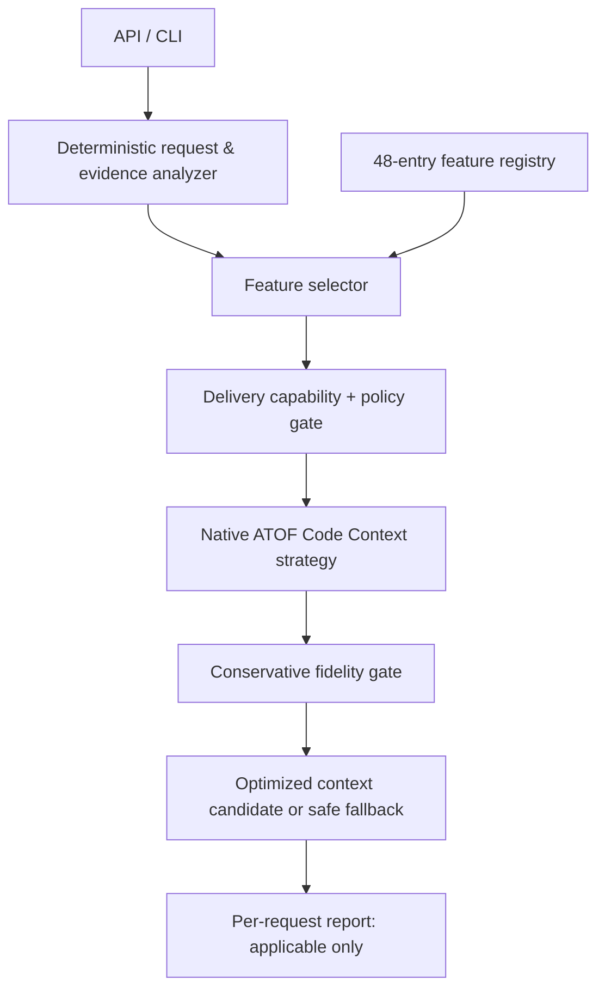

# Phase 1 HLD and testable boundaries

## Strict behavior
- Phase 1 accepts **caller-supplied evidence only**. It does not read the repository automatically or access unapproved files.
- `agent=custom_api` with `delivery_mode=return_payload` is the only eligible path for running a transformation. This models an API caller that explicitly receives and may use the result; it does **not** prove LLM delivery.
- Existing native ATOF code optimizer is reused without trusting its token estimates as actual billing data.
- Conservative fidelity gate rejects empty, non-reducing, or unresolved-dependency payloads. More thorough semantic checks are required before automated edits or production use.
- Other 47 entries are documented for future implementation; no pretend success.
- Analysis and reports are process-local; no database or raw prompts persisted.

## Phase 2 adapter contract
- Define provider-neutral `OptimizationEngine` with `supported_features()` and `optimize()`.
- Integrate reference Token Optimizer **only if licensed and a stable callable interface can be confirmed**. Until then, use independently implemented or first-party engines.
- Add explicit model-request handoff and compare actual provider usage under matched conditions.

## Remaining phases
- Phase 2: provider-neutral engines, context types, safe delivery
- Phase 3: advanced planning, dependency graph, conflicts and budgets
- Phase 4: token usage, fidelity evaluation, ON/OFF benchmarks, reporting UI
- Phase 5: multi-agent adapters and tool discovery
- Phase 6: enterprise security, memory, routing, caching, guarded rollout
